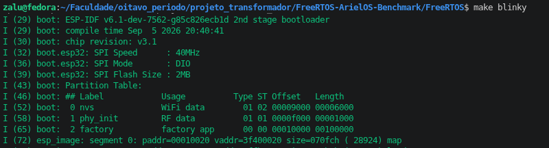
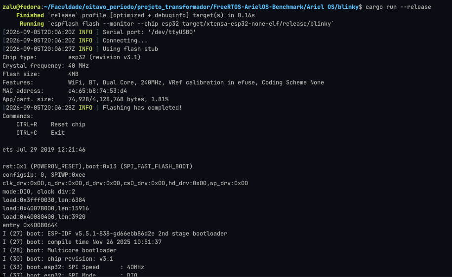

# FreeRTOS x Ariel OS Benchmark

Benchmark comparativo entre FreeRTOS (C) e Ariel OS (Rust) na ESP32-WROOM-32, com três
aplicações de complexidade crescente (Blinky, UART-to-LED e IoT). As métricas são jitter
periódico, latência de interrupção, latência de troca de tarefa e footprint de Flash/RAM.
O protocolo de medição segue Wang et al. Concurrency Frameworks for Embedded Systems: A
Comparative Evaluation of FreeRTOS, RTIC, and Embassy: 1005 amostras por métrica, das quais as 5
primeiras são descartadas, em **ciclos de CPU** (registrador CCOUNT, 240 MHz).

## Estrutura

| Caminho | Conteúdo |
| --- | --- |
| `FreeRTOS/{blinky,uart-to-led,iot}` | Aplicações ESP-IDF |
| `FreeRTOS/components/bench_common` | Coletor e exportação de amostras (C) |
| `Ariel OS/{blinky2,uart-to-led,iot}` | Aplicações Ariel OS |
| `Ariel OS/bench-common` | Coletor e exportação de amostras (Rust) |
| `tools/capture.py` | Captura N execuções pela serial, com reset e validação |
| `tools/collect.py` | Estatísticas por execução, entre execuções e comparação Ariel × FreeRTOS |
| `tools/footprint.py` | Footprint de Flash/RAM a partir do ELF |
| `tools/tests` | Testes de host (`python3 -m unittest discover -s tools/tests`) |

### Métricas por aplicação

| Aplicação | FreeRTOS | Ariel OS |
| --- | --- | --- |
| Blinky | jitter 1/10/100 ms | jitter 1/10/100 ms |
| UART-to-LED | task-switch, latência de interrupção | task-switch, latência de interrupção |
| IoT | jitter 10 ms, interrupção, task-switch, tempo de processamento | jitter 10 ms, interrupção, task-switch, tempo de processamento |

O UART-to-LED dos dois sistemas usa o mesmo protocolo de captura. A metodologia,
os limites da comparação com Wang e a validação sem placa estão no
[README do UART Ariel OS](Ariel%20OS/uart-to-led/README.md). O jitter periódico
não se aplica a essa aplicação, que é acionada por comandos externos.

## 1. Instalação (uma vez)

Os comandos assumem Linux ou WSL e devem ser executados a partir da raiz do repositório.

<details>
  <summary>Dependências do sistema</summary>

  ```bash
  sudo apt install git python3 python3-venv python3-serial libusb-1.0-0
  ```

  - `python3-serial` (pyserial) é usado por `tools/capture.py`.
  - No **WSL**, a placa precisa ser repassada do Windows com
    [usbipd-win](https://github.com/dorssel/usbipd-win): `usbipd attach --wsl --busid <id>`.
    Ela aparece como `/dev/ttyUSB0`.
</details>

<details>
  <summary>FreeRTOS (ESP-IDF)</summary>

  ```bash
  cd FreeRTOS
  make setup          # clona o ESP-IDF em FreeRTOS/esp-idf e executa o install
  ```

  Para usar o ESP-IDF, ative-o em cada terminal:

  ```bash
  source FreeRTOS/esp-idf/export.sh
  ```

  > **Finais de linha:** se o ESP-IDF tiver sido clonado por um git do Windows com
  > `core.autocrlf=true`, os scripts ficam com CRLF e o `idf.py` falha com
  > `env: 'python\r': No such file or directory`. Para corrigir:
  > ```bash
  > cd FreeRTOS/esp-idf
  > git config core.autocrlf false
  > git checkout -- .
  > git submodule foreach --recursive 'git config core.autocrlf false && git checkout -- .'
  > ```

  > **Caminhos longos (Windows):** em caso de erro `Filename too long`, execute
  > `git config --global core.longpaths true`.
</details>

<details>
  <summary>Ariel OS (Rust)</summary>

  Pré-requisito: [rustup](https://rustup.rs/).

  ```bash
  cargo install espup --locked
  espup install                  # toolchain Xtensa; gera ~/export-esp.sh
  cargo install laze espflash --locked
  ```

  Ative o ambiente em cada terminal:

  ```bash
  . ~/export-esp.sh
  ```

  Mais detalhes no [README do espup](https://github.com/esp-rs/espup?tab=readme-ov-file#environment-variables-setup).
</details>

## 2. Compilar e gravar

Grave **um firmware por vez**. A porta usada nos exemplos é `/dev/ttyUSB0`.

**FreeRTOS** (com o ESP-IDF ativado):

```bash
idf.py -C FreeRTOS/blinky      -p /dev/ttyUSB0 build flash
idf.py -C FreeRTOS/uart-to-led -p /dev/ttyUSB0 build flash
idf.py -C FreeRTOS/iot         -p /dev/ttyUSB0 build flash
```

Os `sdkconfig.defaults` fixam:
- CPU em 240 MHz;
- um núcleo;
- tick de 1 ms;
- otimização de desempenho;
- *task watchdog* desligado.

O ESP-IDF só aplica esses valores se **não existir** um `sdkconfig` local. Depois de alterar
os defaults, apague `FreeRTOS/<app>/sdkconfig` antes de compilar.

**Ariel OS** (com o `export-esp.sh` ativado):

```bash
cd "Ariel OS/blinky2"     && laze build -b espressif-esp32-devkitc flash && cd ../..
cd "Ariel OS/uart-to-led" && laze build -b espressif-esp32-devkitc flash && cd ../..
cd "Ariel OS/iot"         && laze build -b espressif-esp32-devkitc flash && cd ../..
```

Para apenas ver uma aplicação funcionando, sem coleta, use `make blinky|uart|iot` em
`FreeRTOS/` (compila, grava e abre o monitor) ou `laze build -b espressif-esp32-devkitc run`
no Ariel OS.

## 3. Capturar as medições

O `tools/capture.py`:
- reinicia a placa (DTR/RTS) antes de cada execução e grava `<os>_<app>_<NN>.log`;
- recusa sobrescrever logs existentes;
- valida cada execução antes de seguir para a próxima:
  - protocolo 0.2.0 em ciclos;
  - `ccount_per_100ms` próximo de 24.000.000;
  - 1000 amostras por métrica;
  - nenhum evento perdido.

**Feche qualquer monitor serial antes de capturar.**

Comando geral:

```bash
python3 tools/capture.py --os <freertos|ariel-os> --app <blinky|uart-to-led|iot> \
  --port /dev/ttyUSB0 --runs 5 --out runs/piloto/<os>-<app>
```

Exemplos:

```bash
# com o firmware FreeRTOS/blinky gravado
python3 tools/capture.py --os freertos --app blinky --port /dev/ttyUSB0 --runs 5 --out runs/piloto/freertos-blinky

# com o firmware FreeRTOS/uart-to-led gravado (o script envia 1005 comandos)
python3 tools/capture.py --os freertos --app uart-to-led --port /dev/ttyUSB0 --runs 5 \
  --interval-ms 500 --out runs/piloto/freertos-uart

# com o firmware "Ariel OS/uart-to-led" gravado
python3 tools/capture.py --os ariel-os --app uart-to-led --port /dev/ttyUSB0 --runs 5 \
  --interval-ms 500 --out runs/piloto/ariel-uart

# com o firmware "Ariel OS/iot" gravado
python3 tools/capture.py --os ariel-os --app iot --port /dev/ttyUSB0 --runs 5 --out runs/piloto/ariel-iot
```

No Ariel OS, o nome da app nos logs é `blinky`, embora a pasta seja `blinky2`.

Duração aproximada de cada execução:

| Aplicação | Por execução |
| --- | --- |
| Blinky | ~2 min |
| IoT | ~15 s |
| UART-to-LED (500 ms entre comandos) | ~8,4 min |

> **Execução rejeitada:** o script para e preserva o log parcial. A causa mais comum no WSL é
> a perda de um pacote USB (linhas `SAMPLE` fundidas). A perda ocorre na exportação, depois da
> janela de medição, então repetir a execução não enviesa os dados. Renomeie o log rejeitado
> (por exemplo, `.invalid`), anote o descarte e capture as execuções restantes em outra pasta.

## 4. Footprint

```bash
A="Ariel OS/build/bin/espressif-esp32-devkitc/cargo/xtensa-esp32-none-elf/release"
{
  python3 tools/footprint.py FreeRTOS/blinky/build/blinky.elf           --app blinky      --os freertos
  python3 tools/footprint.py FreeRTOS/uart-to-led/build/uart_to_led.elf --app uart-to-led --os freertos
  python3 tools/footprint.py FreeRTOS/iot/build/iot.elf                 --app iot         --os freertos
  python3 tools/footprint.py "$A/blinky2"     --app blinky      --os ariel-os
  python3 tools/footprint.py "$A/uart-to-led" --app uart-to-led --os ariel-os
  python3 tools/footprint.py "$A/iot"         --app iot         --os ariel-os
} > runs/piloto/footprint.log
```

A RAM estática não é comparável diretamente entre os dois sistemas:
- no FreeRTOS, pilhas e TCBs ficam no heap e não aparecem no ELF;
- no Ariel OS, a reserva de heap entra como dados zerados.

## 5. Agregar e comparar

```bash
python3 tools/collect.py runs/piloto/*/*.log runs/piloto/footprint.log -o out/piloto
```

| Arquivo em `out/piloto/` | Conteúdo |
| --- | --- |
| `samples.csv` | amostras brutas |
| `results.csv` | mín, máx, média, desvio, P50, P90 e P99 de cada execução |
| `summary.csv` | agregado entre execuções: média e mediana das médias, desvio entre execuções, pior máximo e pior P99 |
| `compare.csv` | Ariel OS x FreeRTOS lado a lado, com razões |
| `footprint.csv` | Flash/RAM por seção |

Todos os valores estão em ciclos de CPU (1 ciclo ≈ 4,17 ns a 240 MHz). O `collect.py` recusa
misturar logs do protocolo antigo, em µs, com logs em ciclos.

## Exemplos de execução

FreeRTOS (Blinky):



Ariel OS (Blinky):


